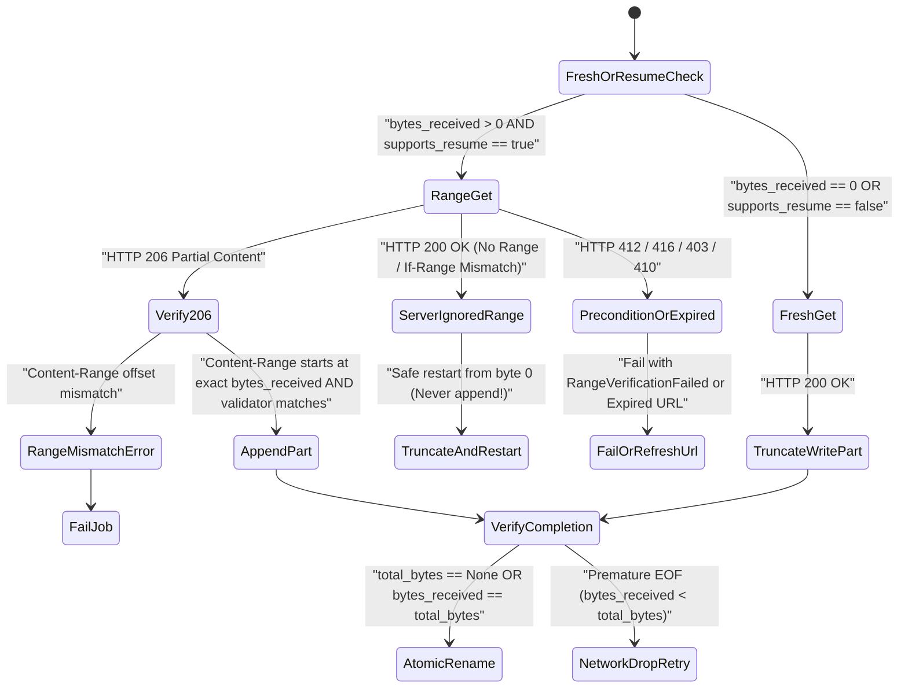

# HyperDownload — API Contracts, Data Models & Persistence Schema

> **Document Status:** Phase 0 Contract Specification  
> **FFI Boundary:** `flutter_rust_bridge` v2.13.0 (`rust/crates/engine_ffi/src/api.rs`)

All Rust domain models in `media_models` use strongly typed structs and enums. Explicit `Option<T>` values represent unknown metadata—never magic sentinel strings (`"unknown"`, `"-1"`, `"0p"`).

---

## 1. Core Domain Data Models (`crates/media_models`)

### 1.1 Providers & Capabilities

```rust
use serde::{Deserialize, Serialize};

#[derive(Debug, Clone, PartialEq, Eq, Hash, Serialize, Deserialize)]
pub enum ProviderId {
    DirectHttp,
    YtDlp,
    Custom(String),
}

#[derive(Debug, Clone, PartialEq, Eq, Serialize, Deserialize)]
pub struct ProviderCapabilities {
    pub supports_metadata_inspection: bool,
    pub supports_playlist_discovery: bool,
    pub supports_direct_media_download: bool,
    pub supports_stream_muxing: bool,
    pub supports_resume_range: bool,
    pub requires_external_extractor: bool,
    pub requires_ffmpeg_for_separate_streams: bool,
}
```

### 1.2 MediaInfo & MediaFormat

```rust
#[derive(Debug, Clone, PartialEq, Eq, Serialize, Deserialize)]
pub enum FormatAvailability {
    /// Technically discovered single stream or direct file ready for download execution.
    /// Does not imply legal or copyright authorization.
    DiscoveredSingle,
    /// Technically discovered video-only/audio-only stream requiring local FFmpeg muxing when paired.
    /// Does not imply legal or copyright authorization.
    DiscoveredRequiresMuxing,
    /// Blocked because the stream uses DRM or requires authentication/membership bypass.
    BlockedDrmOrAccessRestricted { reason: String },
    /// Metadata was fetched, but the platform/source exposes no downloadable stream.
    MetadataOnlyPlatformRestricted { reason: String },
    /// Previously discovered format URL expired or server no longer exposes it.
    ExpiredOrUnavailable { reason: String },
}

/// Distinguishes a single-stream/direct-file selection from a separate video+audio muxed pair.
#[derive(Debug, Clone, PartialEq, Eq, Hash, Serialize, Deserialize)]
pub enum DownloadFormatChoice {
    Single {
        format_id: String,
    },
    MergedVideoAudio {
        video_format_id: String,
        audio_format_id: String,
        target_container: String,
    },
}

impl DownloadFormatChoice {
    /// Canonical stable key used in SQLite deduplication indexes.
    pub fn canonical_key(&self) -> String {
        match self {
            Self::Single { format_id } => format!("single:{format_id}"),
            Self::MergedVideoAudio {
                video_format_id,
                audio_format_id,
                target_container,
            } => format!("mux:{video_format_id}+{audio_format_id}:{target_container}"),
        }
    }
}

#[derive(Debug, Clone, PartialEq, Serialize, Deserialize)]
pub struct MediaFormat {
    pub id: String,
    pub container: String,
    pub mime_type: Option<String>,
    pub width: Option<u32>,
    pub height: Option<u32>,
    pub fps: Option<f32>,
    pub video_codec: Option<String>,
    pub audio_codec: Option<String>,
    pub bitrate_bps: Option<u64>,
    /// File size in bytes when known from authoritative headers or API metadata.
    pub file_size_bytes: Option<u64>,
    /// True if file_size_bytes was estimated (e.g., from duration * bitrate) rather than exact Content-Length.
    pub is_size_estimated: bool,
    pub has_video: bool,
    pub has_audio: bool,
    /// Some(true) = Range verified; Some(false) = Accept-Ranges: none; None = unknown until transfer probe.
    pub supports_range_requests: Option<bool>,
    pub availability: FormatAvailability,
}

#[derive(Debug, Clone, PartialEq, Eq, Serialize, Deserialize)]
pub struct PlaylistSummary {
    pub playlist_id: String,
    pub playlist_title: String,
    pub item_index: u32,
    pub total_items: Option<u32>,
}

#[derive(Debug, Clone, PartialEq, Serialize, Deserialize)]
pub struct MediaInfo {
    pub id: String,
    pub provider: ProviderId,
    pub source_url: String,
    pub title: String,
    pub description: Option<String>,
    pub thumbnail_url: Option<String>,
    pub channel_name: Option<String>,
    pub duration_ms: Option<u64>,
    pub published_at: Option<String>,
    pub playlist_context: Option<PlaylistSummary>,
    pub capabilities: ProviderCapabilities,
    /// Only formats genuinely discovered by the provider. Empty if metadata-only.
    pub formats: Vec<MediaFormat>,
    /// Human-readable explanation when download is restricted or unavailable.
    pub download_restriction: Option<String>,
}
```

### 1.3 Playlists

```rust
#[derive(Debug, Clone, PartialEq, Serialize, Deserialize)]
pub enum PlaylistItemInspectionState {
    PendingInspection,
    Inspecting,
    Ready(MediaInfo),
    Failed(EngineError),
}

#[derive(Debug, Clone, PartialEq, Serialize, Deserialize)]
pub struct PlaylistItemInfo {
    pub item_id: String,
    /// 0-based stable index preserving source playlist order.
    pub order_index: u32,
    pub source_url: String,
    pub title: String,
    pub thumbnail_url: Option<String>,
    pub duration_ms: Option<u64>,
    pub inspection_state: PlaylistItemInspectionState,
}

#[derive(Debug, Clone, PartialEq, Serialize, Deserialize)]
pub struct PlaylistInfo {
    pub id: String,
    pub provider: ProviderId,
    pub source_url: String,
    pub title: String,
    pub description: Option<String>,
    pub channel_name: Option<String>,
    pub thumbnail_url: Option<String>,
    pub total_item_count: Option<u32>,
    pub items: Vec<PlaylistItemInfo>,
    pub capabilities: ProviderCapabilities,
}

#[derive(Debug, Clone, PartialEq, Serialize, Deserialize)]
pub enum InspectionResult {
    SingleMedia(MediaInfo),
    Playlist(PlaylistInfo),
}
```

### 1.4 Download Jobs, Statuses & Errors

```rust
#[derive(Debug, Clone, Copy, PartialEq, Eq, Serialize, Deserialize)]
pub enum DownloadStatus {
    Queued,
    Analyzing,
    Downloading,
    Merging,
    Paused,
    Completed,
    Failed,
    Canceled,
}

#[derive(Debug, Clone, PartialEq, Eq, Serialize, Deserialize)]
pub enum ErrorCode {
    InvalidUrl,
    UnsupportedProvider,
    ExtractorNotReady,
    JsRuntimeMissing,
    FfmpegMissing,
    DrmProtectedContent,
    AuthOrRestrictedSource,
    HttpStatus { status_code: u16 },
    NetworkTransient,
    RangeNotSupported,
    RangeVerificationFailed,
    IntegrityMismatch,
    StoragePermissionDenied,
    DiskFull,
    DatabaseError,
    ExtractionFailed,
    Canceled,
}

#[derive(Debug, Clone, PartialEq, Eq, Serialize, Deserialize)]
pub struct EngineError {
    pub code: ErrorCode,
    pub message: String,
    pub is_retryable: bool,
}

#[derive(Debug, Clone, PartialEq, Eq, Serialize, Deserialize)]
pub struct DownloadErrorInfo {
    pub code: ErrorCode,
    pub message: String,
    pub is_retryable: bool,
    pub attempt_count: u32,
}

/// Durable checkpoint state specific to generic HTTP downloads (`download_core`).
#[derive(Debug, Clone, PartialEq, Eq, Serialize, Deserialize)]
pub struct HttpResumeState {
    pub temp_part_path: String,
    pub supports_range: bool,
    pub etag: Option<String>,
    pub last_modified: Option<String>,
}

/// Current execution stage inside an extractor-backed (`yt-dlp`) job.
#[derive(Debug, Clone, Copy, PartialEq, Eq, Serialize, Deserialize)]
pub enum ExtractorTransferPhase {
    Preparing,
    DownloadingPrimaryStream,
    DownloadingSecondaryAudioStream,
    MergingStreams,
    Finalizing,
}

/// Durable staging checkpoint specific to extractor-backed (`yt-dlp`) jobs.
#[derive(Debug, Clone, PartialEq, Eq, Serialize, Deserialize)]
pub struct ExtractorStagingState {
    pub job_staging_dir: String,
    pub phase: ExtractorTransferPhase,
    pub primary_stream_bytes: u64,
    pub secondary_stream_bytes: u64,
    pub intermediate_files: Vec<String>,
    pub target_merged_path: Option<String>,
}

/// Strictly separates generic HTTP range checkpoints from extractor staging checkpoints.
#[derive(Debug, Clone, PartialEq, Eq, Serialize, Deserialize)]
pub enum ExecutionResumeState {
    DirectHttp(HttpResumeState),
    Extractor(ExtractorStagingState),
}

#[derive(Debug, Clone, PartialEq, Eq, Serialize, Deserialize)]
pub struct DownloadJob {
    pub id: String,
    pub source_id: String,
    pub source_url: String,
    pub provider: ProviderId,
    pub format_choice: DownloadFormatChoice,
    pub playlist_id: Option<String>,
    pub playlist_index: Option<u32>,
    pub file_name: String,
    pub destination_path: String,
    pub status: DownloadStatus,
    pub bytes_received: u64,
    pub total_bytes: Option<u64>,
    pub download_speed_bps: Option<u64>,
    pub estimated_time_remaining_ms: Option<u64>,
    pub resume_state: ExecutionResumeState,
    pub error: Option<DownloadErrorInfo>,
    pub created_at_ms: i64,
    pub updated_at_ms: i64,
}
```

### 1.5 Events & Requests

```rust
#[derive(Debug, Clone, PartialEq, Eq, Serialize, Deserialize)]
pub struct JobProgressUpdate {
    pub job_id: String,
    pub status: DownloadStatus,
    pub bytes_received: u64,
    pub total_bytes: Option<u64>,
    pub download_speed_bps: Option<u64>,
    pub estimated_time_remaining_ms: Option<u64>,
}

#[derive(Debug, Clone, PartialEq, Serialize, Deserialize)]
pub enum EngineEvent {
    JobAdded(DownloadJob),
    JobUpdated(DownloadJob),
    JobProgress(JobProgressUpdate),
    JobRemoved { job_id: String },
    QueueIdle,
}

#[derive(Debug, Clone, PartialEq, Eq, Serialize, Deserialize)]
pub struct EnqueueDownloadRequest {
    pub source_id: String,
    pub source_url: String,
    pub provider: ProviderId,
    pub format_choice: DownloadFormatChoice,
    pub file_name: String,
    pub destination_dir: Option<String>,
    pub playlist_id: Option<String>,
    pub playlist_index: Option<u32>,
}

#[derive(Debug, Clone, PartialEq, Eq, Serialize, Deserialize)]
pub struct DownloadFilter {
    pub statuses: Option<Vec<DownloadStatus>>,
    pub playlist_id: Option<String>,
}

#[derive(Debug, Clone, Copy, PartialEq, Eq, Serialize, Deserialize)]
pub enum ExtractorUpdateChannel {
    Stable,
    Nightly,
}

#[derive(Debug, Clone, PartialEq, Eq, Serialize, Deserialize)]
pub struct ExtractorStatus {
    pub backend_name: String,
    pub available: bool,
    pub version: Option<String>,
    pub js_runtime_detected: Option<String>,
    pub ffmpeg_detected: bool,
    pub ffmpeg_version: Option<String>,
    pub update_channel: ExtractorUpdateChannel,
}

#[derive(Debug, Clone, PartialEq, Eq, Serialize, Deserialize)]
pub struct EngineSettings {
    pub default_download_dir: String,
    pub staging_dir: String,
    pub bin_dir: String,
    pub max_concurrent_downloads: u8,
    pub max_retry_attempts: u8,
    pub wifi_only: bool,
    pub extractor_update_channel: ExtractorUpdateChannel,
    pub js_runtime_override: Option<String>,
    pub ffmpeg_path: Option<String>,
}

#[derive(Debug, Clone, PartialEq, Eq, Serialize, Deserialize)]
pub struct EngineConfig {
    pub database_path: String,
    pub initial_settings: EngineSettings,
}
```

---

## 2. Rust `provider_api` Trait Contract

Every platform integration implements `MediaProvider` in an isolated crate:

```rust
use async_trait::async_trait;
use media_models::{
    EngineError, InspectionResult, MediaInfo, PlaylistInfo, ProviderCapabilities, ProviderId,
};

#[derive(Debug, Clone)]
pub struct DirectStreamTarget {
    pub resolved_url: String,
    pub headers: Vec<(String, String)>,
    pub expected_total_bytes: Option<u64>,
    pub supports_range_requests: Option<bool>,
    pub etag: Option<String>,
    pub last_modified: Option<String>,
    pub suggested_file_name: Option<String>,
}

#[async_trait]
pub trait MediaProvider: Send + Sync {
    fn id(&self) -> ProviderId;

    fn capabilities(&self) -> ProviderCapabilities;

    /// Fast syntactic check whether this adapter handles the given URL.
    fn can_handle(&self, url: &url::Url) -> bool;

    /// Inspects a URL (single media item or playlist) without downloading media payloads.
    async fn inspect(&self, url: &url::Url) -> Result<InspectionResult, EngineError>;

    /// Inspects a specific single media item (used for lazy/independent playlist item discovery).
    async fn inspect_media(&self, url: &url::Url) -> Result<MediaInfo, EngineError>;

    /// Inspects a playlist and returns ordered items.
    async fn inspect_playlist(&self, url: &url::Url) -> Result<PlaylistInfo, EngineError>;

    /// Resolves a fresh direct HTTP download target for a discovered format ID (for DirectHttp/core execution).
    /// Returns Err if the provider uses an extractor-backed execution pipeline instead.
    async fn resolve_direct_stream(
        &self,
        source_url: &url::Url,
        format_id: &str,
    ) -> Result<DirectStreamTarget, EngineError>;
}
```

---

## 2.1 Rust `extractor_backend` Trait Contract (`MediaExtractorBackend`)

Isolates external media extraction (`yt-dlp` on Windows CLI or Android native bridge) from `download_queue`, `persistence`, and `download_core`:

```rust
use tokio::sync::mpsc;
use tokio_util::sync::CancellationToken;

#[derive(Debug, Clone)]
pub struct ExtractorDownloadRequest {
    pub job_id: String,
    pub source_url: String,
    pub format_choice: DownloadFormatChoice,
    pub job_staging_dir: String,
    pub output_template: String,
}

#[derive(Debug, Clone)]
pub enum ExtractorProgressEvent {
    PhaseChanged {
        phase: ExtractorTransferPhase,
    },
    Downloading {
        phase: ExtractorTransferPhase,
        bytes_received: u64,
        total_bytes: Option<u64>,
        speed_bps: Option<u64>,
        eta_ms: Option<u64>,
        intermediate_files: Vec<String>,
    },
    Merging {
        postprocessor: String,
        target_merged_path: Option<String>,
    },
    Completed {
        final_staged_path: String,
        total_bytes: u64,
    },
}

#[async_trait]
pub trait MediaExtractorBackend: Send + Sync {
    async fn backend_status(&self) -> ExtractorStatus;

    async fn can_extract(&self, url: &url::Url) -> bool;

    async fn extract_media_info(&self, url: &url::Url) -> Result<MediaInfo, EngineError>;

    async fn extract_playlist_info(&self, url: &url::Url) -> Result<PlaylistInfo, EngineError>;

    async fn execute_download(
        &self,
        request: ExtractorDownloadRequest,
        progress_tx: mpsc::Sender<ExtractorProgressEvent>,
        cancel_token: CancellationToken,
    ) -> Result<(), EngineError>;

    async fn update_backend(
        &self,
        channel: ExtractorUpdateChannel,
    ) -> Result<ExtractorStatus, EngineError>;
}
```

---

## 3. Flutter <-> Rust (`flutter_rust_bridge` v2) FFI Contract

Exposed in `rust/crates/engine_ffi/src/api.rs` and generated into Dart under `apps/client/lib/core/bridge/frb_generated.dart`:

| Rust FFI Function | Parameters | Return Type | Behavior |
| :--- | :--- | :--- | :--- |
| `init_engine` | `config: EngineConfig` | `Result<(), EngineError>` | Initializes Tokio runtime, opens SQLite DB, runs migrations, recovers interrupted jobs to `Paused`, registers providers. |
| `subscribe_engine_events` | `sink: StreamSink<EngineEvent>` | `Result<(), EngineError>` | Attaches broadcast listener forwarding throttled `JobProgress` (100–250 ms) and immediate `JobUpdated`/`JobAdded` events. |
| `inspect_url` | `url: String` | `Result<InspectionResult, EngineError>` | Validates URL syntax, matches provider via `ProviderRegistry`, returns `SingleMedia` or `Playlist`. |
| `inspect_playlist_item` | `playlist_id: String, item_url: String` | `Result<MediaInfo, EngineError>` | Inspects an individual playlist item independently and updates playlist item cache. |
| `enqueue_download` | `request: EnqueueDownloadRequest` | `Result<DownloadJob, EngineError>` | Checks duplicate `(source_url, format_choice.canonical_key())` non-terminal jobs, validates format availability, inserts `Queued` job, wakes scheduler. |
| `enqueue_playlist_items` | `requests: Vec<EnqueueDownloadRequest>` | `Result<Vec<DownloadJob>, EngineError>` | Atomically queues eligible playlist items while preserving `playlist_index` and skipping duplicates. |
| `pause_download` | `job_id: String` | `Result<DownloadJob, EngineError>` | Triggers job `CancellationToken`, flushes `.part` file, commits exact byte offset and `Paused` state. |
| `resume_download` | `job_id: String` | `Result<DownloadJob, EngineError>` | Validates resumability (`supports_resume` or restart policy), sets `Queued`, wakes scheduler. |
| `cancel_download` | `job_id: String, delete_partial_file: bool` | `Result<DownloadJob, EngineError>` | Stops active transfer, optionally deletes `.part` file, marks job `Canceled`. |
| `retry_download` | `job_id: String` | `Result<DownloadJob, EngineError>` | Resets retry counters on `Failed` job and re-queues it. |
| `list_downloads` | `filter: Option<DownloadFilter>` | `Result<Vec<DownloadJob>, EngineError>` | Queries SQLite jobs sorted by `created_at_ms` / playlist order. |
| `pause_all_downloads` | *(none)* | `Result<u32, EngineError>` | Pauses all `Downloading`/`Queued`/`Analyzing` jobs; returns count paused. |
| `resume_all_downloads` | *(none)* | `Result<u32, EngineError>` | Re-queues all `Paused` jobs; returns count resumed. |
| `retry_failed_in_playlist` | `playlist_id: String` | `Result<Vec<DownloadJob>, EngineError>` | Re-queues all `Failed` jobs belonging to `playlist_id`. |
| `update_settings` | `settings: EngineSettings` | `Result<(), EngineError>` | Updates SQLite settings, adjusts scheduler concurrency semaphore, JS runtime override, and FFmpeg paths. |
| `get_extractor_status` | *(none)* | `Result<ExtractorStatus, EngineError>` | Checks `yt-dlp` availability/version, detected JS runtime (`Deno`/`Node`/`QuickJS`), and FFmpeg availability. |
| `update_extractor_backend` | `channel: ExtractorUpdateChannel` | `Result<ExtractorStatus, EngineError>` | Triggers SHA-256 verified update of `yt-dlp` (`Stable` or `Nightly`) without interrupting active downloads. |
| `flush_and_checkpoint_for_suspend` | *(none)* | `Result<u32, EngineError>` | Invoked by Android `JobService.onStopJob` / Windows shutdown to cleanly flush all active `.part` files/subprocesses and persist SQLite checkpoints. |

> **Dart Wrapper Rule:** Flutter Blocs depend on an abstract Dart `DownloadEngineClient` interface rather than calling global FRB functions directly. This enables instant mocking with `mocktail` in `bloc_test` unit suites.

---

## 3.1 Android Native JNI Bridge Contract (`engine_ffi/src/android_jni.rs`)

Enables `HyperDownloadJobService` (UIDT) and Chaquopy (`AndroidPlatformBridge`) to communicate directly with the Rust engine even when Flutter's UI isolate is absent:

| Direction | Symbol / Method | Signature / Responsibility |
| :--- | :--- | :--- |
| **Kotlin -> Rust** | `NativeEngineJni.ensureEngineInitialized` | `(dbPath: String, settingsJson: String) -> Boolean` — Idempotently boots Tokio runtime, opens SQLite WAL, runs `reconcile_interrupted_jobs_on_startup()`. |
| **Kotlin -> Rust** | `NativeEngineJni.registerPlatformBridge` | `(bridge: AndroidPlatformBridge) -> Unit` — Stores `GlobalRef` to Kotlin bridge in Rust `OnceLock`. |
| **Kotlin -> Rust** | `NativeEngineJni.resumeQueueFromBackgroundService` | `() -> Int` — Starts/wakes `download_queue` scheduler headlessly for pending `Queued`/resumable jobs; returns active job count. |
| **Kotlin -> Rust** | `NativeEngineJni.onExtractorProgress` | `(jobId: String, eventJson: String) -> Unit` — Feeds throttled Chaquopy `progress_hooks` / `postprocessor_hooks` into `download_queue` + SQLite checkpoints + `StreamSink`. |
| **Kotlin -> Rust** | `NativeEngineJni.onServiceStopping` | `(userCanceled: Boolean) -> Int` — Cancels active tokens, invokes `cancelTask`, flushes checkpoints on optional `onStopJob()`. |
| **Rust -> Kotlin** | `AndroidPlatformBridge.extractMediaInfo` | `(url: String, optsJson: String) -> String` — Calls Chaquopy `hyperdl_ytdlp_worker.inspect_video`. |
| **Rust -> Kotlin** | `AndroidPlatformBridge.extractPlaylistInfo` | `(url: String, optsJson: String) -> String` — Calls Chaquopy `hyperdl_ytdlp_worker.inspect_playlist`. |
| **Rust -> Kotlin** | `AndroidPlatformBridge.executeDownload` | `(jobId: String, reqJson: String) -> String` — Runs `yt-dlp` transfer + `libffmpeg.so` muxing via Chaquopy `Dispatchers.IO`. |
| **Rust -> Kotlin** | `AndroidPlatformBridge.cancelTask` | `(jobId: String) -> Unit` — Sets `cancelled_jobs[jobId]` and terminates/kills tracked `libqjs.so`/`libffmpeg.so` child processes. |
| **Rust -> Kotlin** | `AndroidPlatformBridge.updateServiceNotification` | `(summaryJson: String) -> Unit` — Updates UIDT `JobService` / `WorkManager` foreground progress notification. |
| **Rust -> Kotlin** | `AndroidPlatformBridge.onQueueIdle` | `() -> Unit` — Signals `HyperDownloadJobService` to invoke `jobFinished(params, false)`. |

---

## 4. SQLite Persistence Schema (`crates/persistence`)

SQLite is opened with `PRAGMA journal_mode = WAL; PRAGMA foreign_keys = ON; PRAGMA synchronous = NORMAL;`.

```sql
CREATE TABLE IF NOT EXISTS schema_migrations (
    version INTEGER PRIMARY KEY,
    applied_at_ms INTEGER NOT NULL
);

CREATE TABLE IF NOT EXISTS download_jobs (
    id TEXT PRIMARY KEY,
    source_id TEXT NOT NULL,
    source_url TEXT NOT NULL,
    provider TEXT NOT NULL,
    format_choice_key TEXT NOT NULL,
    format_choice_json TEXT NOT NULL,
    playlist_id TEXT NULL,
    playlist_index INTEGER NULL,
    file_name TEXT NOT NULL,
    destination_path TEXT NOT NULL,
    status TEXT NOT NULL CHECK (
        status IN ('queued', 'analyzing', 'downloading', 'merging', 'paused', 'completed', 'failed', 'canceled')
    ),
    bytes_received INTEGER NOT NULL DEFAULT 0,
    total_bytes INTEGER NULL,
    resume_state_type TEXT NOT NULL CHECK (
        resume_state_type IN ('direct_http', 'extractor')
    ),
    resume_state_json TEXT NOT NULL,
    error_code TEXT NULL,
    error_message TEXT NULL,
    error_retryable INTEGER NOT NULL DEFAULT 0,
    attempt_count INTEGER NOT NULL DEFAULT 0,
    created_at_ms INTEGER NOT NULL,
    updated_at_ms INTEGER NOT NULL
);

CREATE INDEX IF NOT EXISTS idx_download_jobs_status
    ON download_jobs(status, created_at_ms);

CREATE INDEX IF NOT EXISTS idx_download_jobs_playlist
    ON download_jobs(playlist_id, playlist_index);

-- Prevents duplicate active/queued/merging/paused jobs for the same media source & complete format choice
CREATE UNIQUE INDEX IF NOT EXISTS idx_download_jobs_active_dedup
    ON download_jobs(source_url, format_choice_key)
    WHERE status IN ('queued', 'analyzing', 'downloading', 'merging', 'paused');

-- Segment table prepares schema for verified multi-connection range transfers (Milestone 4+)
CREATE TABLE IF NOT EXISTS download_segments (
    job_id TEXT NOT NULL,
    segment_index INTEGER NOT NULL,
    range_start INTEGER NOT NULL,
    range_end INTEGER NOT NULL,
    bytes_written INTEGER NOT NULL DEFAULT 0,
    completed INTEGER NOT NULL DEFAULT 0,
    PRIMARY KEY (job_id, segment_index),
    FOREIGN KEY (job_id) REFERENCES download_jobs(id) ON DELETE CASCADE
);

CREATE TABLE IF NOT EXISTS playlists (
    id TEXT PRIMARY KEY,
    provider TEXT NOT NULL,
    source_url TEXT NOT NULL,
    title TEXT NOT NULL,
    channel_name TEXT NULL,
    thumbnail_url TEXT NULL,
    total_item_count INTEGER NULL,
    created_at_ms INTEGER NOT NULL,
    updated_at_ms INTEGER NOT NULL
);

CREATE TABLE IF NOT EXISTS playlist_items (
    playlist_id TEXT NOT NULL,
    item_id TEXT NOT NULL,
    order_index INTEGER NOT NULL,
    source_url TEXT NOT NULL,
    title TEXT NOT NULL,
    thumbnail_url TEXT NULL,
    duration_ms INTEGER NULL,
    inspection_state_json TEXT NOT NULL,
    PRIMARY KEY (playlist_id, item_id),
    FOREIGN KEY (playlist_id) REFERENCES playlists(id) ON DELETE CASCADE
);

CREATE INDEX IF NOT EXISTS idx_playlist_items_order
    ON playlist_items(playlist_id, order_index);

CREATE TABLE IF NOT EXISTS app_settings (
    key TEXT PRIMARY KEY,
    value_json TEXT NOT NULL,
    updated_at_ms INTEGER NOT NULL
);
```

### Continuous Checkpoints & Crash-Recovery Startup Semantics (`SIGKILL` Safe)
1. **Continuous Checkpointing (No Callback Dependency):** During execution, `download_core` and `download_queue` flush and commit SQLite checkpoints every **1 second** or **1 MiB** written (and immediately on phase transitions), never relying exclusively on `JobService.onStopJob()`.
2. **Startup Reconciliation (`reconcile_interrupted_jobs_on_startup`):** Executed unconditionally during `init_engine` / `ensureEngineInitialized` for any row left in `status IN ('analyzing', 'downloading', 'merging')`:
   - **`ExecutionResumeState::DirectHttp(http)`:** Stat `http.temp_part_path` on disk (`actual_part_bytes`). If `http.supports_range == true`, reconcile `bytes_received = actual_part_bytes` (validated strictly with `Range` + `If-Range` on resume) and set `status = 'paused'` (or `'queued'` if UIDT auto-resume). If `http.supports_range == false`, truncate `.part` to `0`, set `bytes_received = 0`, and set `status = 'paused'`.
   - **`ExecutionResumeState::Extractor(ext)`:** Scan `ext.job_staging_dir`:
     - If interrupted during `MergingStreams`: delete partial incomplete mux output (`*.temp.*`) while retaining completed component video/audio files (`*.f<id>.*`), reset `phase = DownloadingSecondaryAudioStream` (or ready-to-mux) so `yt-dlp --continue` skips re-downloading completed streams and re-runs FFmpeg muxing cleanly.
     - If interrupted during `DownloadingPrimaryStream` / `DownloadingSecondaryAudioStream`: retain `*.part` and `.ytdl` artifacts, sum disk bytes into `bytes_received`, and transition cleanly to `paused` (or `queued` on UIDT reschedule).

---

## 5. HTTP Range & Integrity Validation Protocol



### Non-Negotiable Integrity Rules
1. **Never append on `200 OK`:** If `bytes_received > 0` and the server responds with `200 OK` instead of `206 Partial Content`, `download_core` **MUST NOT** append the response body to `.part`. It must truncate `.part` to `0` and restart cleanly from offset `0` (updating `supports_resume = false` if `Accept-Ranges: none`).
2. **Exact `Content-Range` Match:** On `206 Partial Content`, parse `Content-Range: bytes <start>-<end>/<total_or_star>`. Verify `<start> == bytes_received` before writing a single byte.
3. **Validator Check (`If-Range` / `ETag`):** Send `If-Range: <etag>` (or `<last_modified>`) when available so the server rejects stale partial resumes if the remote file changed.
4. **Premature EOF Detection:** If `total_bytes` is known (`Content-Length` or `Content-Range` total) and the response stream reaches EOF with `bytes_received != total_bytes`, treat as a retryable transient interruption (`NetworkTransient`)—**never** mark the job `Completed`.
