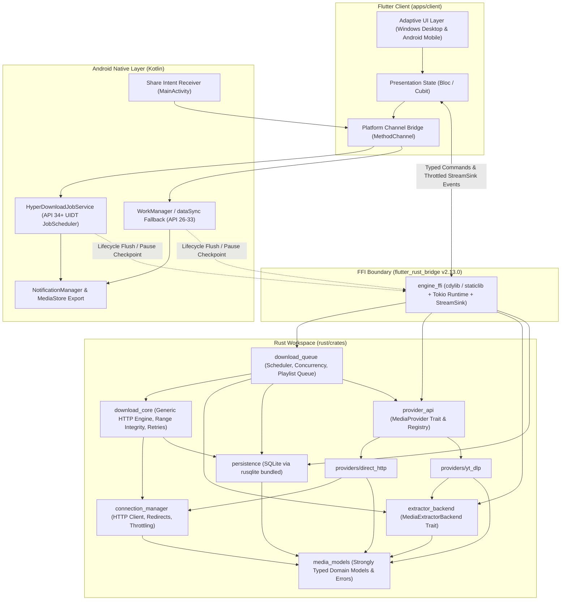
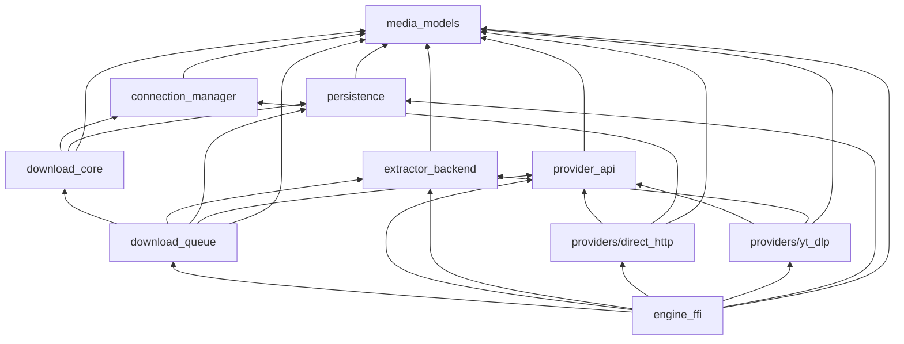
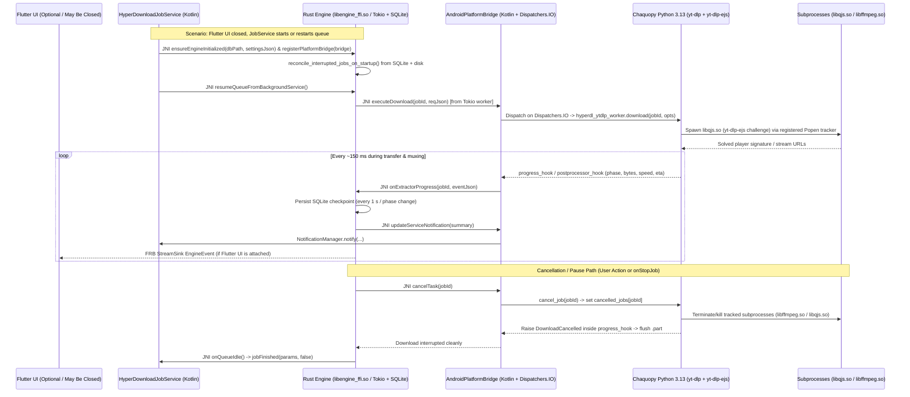

# HyperDownload — System Architecture

> **Document Status:** Phase 0 Architecture Specification  
> **Target Platforms:** Windows Desktop (Windows 10/11 x64) and Android (API 26–36)  
> **Primary Runtime:** Flutter 3.44.1 / Dart 3.12.1 + Rust (`flutter_rust_bridge` v2.13.0) + Kotlin (Android Native)

---

## 1. System Overview & Architectural Principles

**HyperDownload** is a cross-platform media and file download manager engineered around strict separation of concerns, byte-level integrity guarantees, and platform-authentic background execution.

### Core Design Principles

1. **Strict Layer Isolation:**
   - **Flutter / Dart (`apps/client`):** Responsible strictly for UI rendering, declarative navigation, form/link input, Bloc/Cubit presentation state, format selection UI, user settings management, and invoking the Rust engine through generated FFI bindings. Business-critical download state machines, HTTP networking, retry policies, and file-system writes never live in Dart/Flutter widgets.
   - **Rust Engine (`rust/crates/*`):** Owns all HTTP/HTTPS networking, provider adapter dispatch, dynamic format inspection, connection management, pause/resume/cancel control, retry backoff, speed/ETA computation, SQLite persistence, and post-download verification or authorized FFmpeg orchestration.
   - **Native Platform Layers (Android Kotlin / Windows Runner):** Own OS-level lifecycle integration that cannot be safely managed inside an isolated Dart or Rust runtime—specifically Android `ACTION_SEND` Share Intents, User-Initiated Data Transfer (`JobScheduler` UIDT) / Foreground Service execution, notifications, storage permissions/MediaStore export, and Windows desktop integration.
2. **Zero Large Buffer Copying Across FFI:**
   - Media bytes flow directly from `reqwest` TCP/TLS response streams into buffered `tokio::fs::File` writes on disk.
   - The `flutter_rust_bridge` v2 boundary carries only compact control commands, typed metadata models, SQLite job snapshots, and throttled `StreamSink<EngineEvent>` progress events.
3. **Dynamic Discovery Without Fabrication:**
   - Formats, resolutions, codecs, bitrates, and byte sizes are never hardcoded or guessed. A provider may only surface formats explicitly discovered via server headers or official platform API responses.
   - Metadata availability is strictly decoupled from media download authorization.
4. **Byte-Range Safety First:**
   - Partial `.part` files are never appended unless the server explicitly returns `206 Partial Content` with a validated `Content-Range` matching the expected byte offset and a matching `If-Range` / `ETag` / `Last-Modified` validator.

---

## 2. High-Level Layered Architecture



---

## 3. Final Repository Structure & Justified Improvements

The repository expands upon the initial proposed layout with three concrete structural refinements in `rust/crates/` to keep domain crates clean, testable, and free of FFI boilerplate:

```text
hyper_downloader/
│
├── apps/
│   └── client/                         # Flutter application (Windows & Android)
│       ├── lib/
│       │   ├── app/                    # App bootstrap, GoRouter, theme, DI, BlocObserver
│       │   ├── core/
│       │   │   ├── bridge/             # FRB generated bindings & typed engine repository wrapper
│       │   │   ├── platform/           # Android Share Intent & background service MethodChannels
│       │   │   ├── widgets/            # Shared adaptive UI components
│       │   │   └── utils/              # Formatters (bytes, speed, duration), validators
│       │   └── features/
│       │       ├── link_input/         # Home URL input, clipboard/share intake
│       │       ├── media_inspection/   # Metadata preview & restriction diagnostics
│       │       ├── format_selection/   # Dynamic format list & capability badges
│       │       ├── downloads/          # Active queue & completed downloads screens/Blocs
│       │       ├── playlists/          # Playlist inspection & per-item state controls
│       │       └── settings/           # Storage path, concurrency, API key/OAuth, FFmpeg path
│       ├── android/                    # Kotlin MainActivity, JobService (UIDT), Manifest
│       ├── windows/                    # CMakeLists.txt + Cargokit integration + runner
│       ├── test/                       # Flutter unit, widget, and bloc_test suites
│       └── pubspec.yaml
│
├── rust/
│   ├── Cargo.toml                      # Workspace manifest & shared dependency pinning
│   ├── flutter_rust_bridge.yaml        # FRB v2 codegen configuration
│   └── crates/
│       ├── media_models/               # Pure domain structs, enums, ErrorCode, EngineEvent
│       ├── provider_api/               # MediaProvider trait, ProviderRegistry, URL router
│       ├── extractor_backend/          # [ADDED] MediaExtractorBackend trait & yt-dlp adapters (Windows CLI / Android bridge)
│       ├── providers/
│       │   ├── direct_http/            # [ADDED] Generic HTTP/HTTPS provider adapter
│       │   └── yt_dlp/                 # [ADDED] Extractor-backed MediaProvider (YouTube & supported public sites)
│       ├── connection_manager/         # reqwest/rustls HTTP pool, redirect policy, range headers
│       ├── persistence/                # SQLite schema, migrations, job/playlist/settings repos
│       ├── download_core/              # Single-job HTTP download executor, .part I/O, checksum/range guard
│       ├── download_queue/             # Multi-job queue manager, concurrency limits, playlist orchestration
│       ├── engine_ffi/                 # [ADDED] FRB v2 facade crate (cdylib/staticlib + Tokio runtime)
│       └── test_server/                # [ADDED] Local Axum HTTP test server for 10+ failure/range scenarios
│
├── integration_tests/                # Cross-layer Flutter + Rust engine integration suites
│
├── docs/
│   ├── ARCHITECTURE.md
│   ├── PRODUCT_SPEC.md
│   ├── API_CONTRACTS.md
│   ├── TESTING_STRATEGY.md
│   ├── DEVELOPMENT_GUIDE.md
│   ├── YT_DLP_FEASIBILITY_AND_PROTOTYPE.md
│   └── decisions/
│       ├── ADR-0001.md
│       └── ADR-0002.md
│
└── README.md
```

### Justification for Added Crates

1. **`rust/crates/engine_ffi/`**: Isolates `flutter_rust_bridge` v2 macros, `frb_generated.rs`, and the global Tokio runtime away from pure Rust domain logic. This keeps `download_core`, `download_queue`, and `persistence` compilable and testable via `cargo test` with zero Flutter or FFI linker dependencies.
2. **`rust/crates/extractor_backend/`**: Defines the independent `MediaExtractorBackend` abstraction and platform-specific `yt-dlp` runtime drivers (Windows standalone `yt-dlp.exe` + JS runtime + `ffmpeg.exe`; Android native bridge callback into Kotlin/Chaquopy + `libqjs.so` + `libffmpeg.so`).
3. **`rust/crates/providers/direct_http/`**: Implements ordinary HTTP/HTTPS file inspection (`HEAD` + fallback `Range: bytes=0-0` probing, `Content-Disposition` filename resolution, `Accept-Ranges` detection) as a first-class `MediaProvider`, delegating transfer execution to `download_core`.
4. **`rust/crates/providers/yt_dlp/`**: Implements `MediaProvider` on top of `MediaExtractorBackend` for YouTube and supported public platforms, mapping `--dump-single-json` and `--flat-playlist` outputs into strongly typed `MediaInfo`, `MediaFormat`, and `PlaylistInfo` models without reimplementing extraction logic in Rust.
5. **`rust/crates/test_server/`**: Provides a deterministic, local, programmable HTTP/HTTPS test server built with `axum` so Rust engine tests and Flutter integration tests run offline without relying on flaky external URLs.

### Dual Execution Path Under `download_queue`

To avoid duplicating `yt-dlp`'s adaptive stream fetching and FFmpeg post-processing while keeping generic HTTP downloads 100% pure Rust:
- **Direct HTTP Jobs (`ProviderId::DirectHttp`):** Executed directly by Rust's `download_core` + `connection_manager` (`206 Partial Content` / `If-Range` / segmented downloads).
- **Extractor-Backed Jobs (`ProviderId::YtDlp`):** Executed through `MediaExtractorBackend::execute_download(...)`, which runs `yt-dlp` (with `--continue`, JS runtime, and `--ffmpeg-location` when merging separate audio+video streams) and emits normalized progress (`Downloading -> Merging -> Completed`) into `download_queue` and SQLite.

---

## 4. Core Rust Crate Boundaries & Dependency DAG

To prevent circular dependencies and enforce clean modularity, Rust workspace dependencies form a strict Directed Acyclic Graph (DAG):



| Crate | Single Responsibility | Must NOT Contain |
| :--- | :--- | :--- |
| `media_models` | Strongly typed domain DTOs, status enums, `EngineError`, `EngineEvent`, `MediaFormat`, `DownloadJob`. | Network calls, SQL queries, file I/O, FFI macros. |
| `provider_api` | `MediaProvider` async trait, capability flags, URL routing/registry. | Platform-specific extraction or download execution. |
| `extractor_backend` | Independent `MediaExtractorBackend` trait, `yt-dlp` CLI/bridge execution driver, JSON/progress template parsers, JS runtime & FFmpeg location resolution, updater. | Queue scheduling or SQLite persistence logic. |
| `providers/direct_http` | Generic HTTP/HTTPS `HEAD`/`GET` header inspection, filename extraction, range capability probing. | Download byte streaming or SQLite writes. |
| `providers/yt_dlp` | `MediaProvider` adapter delegating URL inspection, playlist enumeration, and format filtering to `MediaExtractorBackend`. | Custom YouTube HTML/JS scraping, cipher decryption, cookie spoofing, or SQLite writes. |
| `connection_manager` | Configured `reqwest` client (`rustls`), redirect tracking, timeout policy, HTTP range header construction & validation, retry primitives. | Queue persistence or UI logic. |
| `persistence` | Embedded SQLite connection (`rusqlite` bundled), WAL mode, schema migrations, CRUD for jobs, segments, playlists, and settings. | Network requests or active task handles. |
| `download_core` | Single-job HTTP state machine, `.part` file creation/append verification, speed/ETA sliding-window calculation, cooperative cancellation via `CancellationToken`. | Multi-job scheduling or media extractor logic. |
| `download_queue` | Concurrency semaphore, FIFO scheduling, pause-all/resume-all, duplicate-job detection, playlist batch orchestration, crash recovery, dual routing (`download_core` vs `MediaExtractorBackend`). | Flutter FFI glue or platform-specific APIs. |
| `engine_ffi` | `flutter_rust_bridge` v2 entry points, Tokio multi-threaded runtime initialization, throttled `StreamSink` dispatcher, Android/Windows extractor callbacks. | Business rules (delegates strictly to `download_queue` and `provider_api`). |
| `test_server` | Dev/test programmable Axum server implementing all 10 HTTP test scenarios. | Production application dependencies. |

---

## 5. `flutter_rust_bridge` v2 Integration Architecture

HyperDownload uses **`flutter_rust_bridge` v2 (`2.13.0`)** with **Cargokit** as the default build orchestrator:

- **Windows Build Integration:** `apps/client/windows/CMakeLists.txt` invokes Cargokit during `flutter build windows` / `flutter run -d windows`, compiling `engine_ffi` for `x86_64-pc-windows-msvc` into `engine_ffi.dll` and bundling it next to the Flutter executable.
- **Android Build Integration:** `apps/client/android/app/build.gradle.kts` invokes Cargokit with Android NDK (`28.2.13676358` / `29.0.14206865`), cross-compiling `engine_ffi` into 16 KB page-aligned `libengine_ffi.so` for `arm64-v8a` (`aarch64-linux-android`) and `x86_64` (`x86_64-linux-android`, plus optional `armeabi-v7a`).
- **Async & Event Streaming Model:**
  - `engine_ffi` initializes a singleton `tokio::runtime::Runtime` (multi-threaded) via `std::sync::OnceLock` during `init_engine` (triggered either by Flutter UI or headlessly by Android `HyperDownloadJobService`).
  - Dart establishes a long-lived event subscription via `subscribe_engine_events() -> Stream<EngineEvent>` backed by FRB's `StreamSink<EngineEvent>`.
  - To avoid flooding the Dart isolate during multi-megabit transfers, per-job `JobProgress` events are **coalesced and throttled to 100–250 ms intervals** inside Rust, while discrete lifecycle transitions (`Queued -> Downloading -> Merging -> Completed`, `Paused`, `Failed`, `Canceled`) are emitted **immediately**.
- **Media Processing & Extractor Binaries (Windows & Android):**
  - FFmpeg is **not** statically linked into the Rust binary (avoiding GPL/LGPL static linking contamination).
  - **Windows:** Standalone `yt-dlp.exe`, an external JS runtime (**Deno `>= 2.3.0`**, **Node.js `>= 22.0.0`**, or **QuickJS `>= 2025-4-26`**), and `ffmpeg.exe`/`ffprobe.exe` live in `%LOCALAPPDATA%\HyperDownload\bin\` and are invoked out-of-process.
  - **Android:** Chaquopy `17.2.0` (`>= 16.0.0`, MIT) embeds **Python `3.13`** + `yt-dlp` + `yt-dlp-ejs` + `certifi` (excluding GPL-2.0+ `mutagen`), with pure-Python wheel updates in `filesDir` (`sys.path[0]`, W^X safe). Cross-compiled 16 KB page-aligned PIE binaries `libqjs.so` (`QuickJS >= 2025-4-26`), `libffmpeg.so`, and `libffprobe.so` live in `jniLibs/<abi>/` with `android:extractNativeLibs="true"` and `packaging.jniLibs.useLegacyPackaging = true`, symlinked inside `<filesDir>/bin/` (`ffmpeg`, `ffprobe`, `qjs`) so `yt-dlp` finds them under SELinux/W^X constraints.

---

## 6. Android Native Layer Architecture (Kotlin)

Android aggressively kills background processes (`SIGKILL` via LMKD/OEM killers) and enforces strict foreground/background execution policies. Never assume an asynchronous Rust Tokio task survives backgrounding, and never assume `JobService.onStopJob()` will be delivered before process death.

### 6.1 Share Intent Intake

1. `apps/client/android/app/src/main/AndroidManifest.xml` declares an `<intent-filter>` on `MainActivity` for `android.intent.action.SEND` with `mimeType="text/plain"`.
2. `MainActivity.kt` extracts `Intent.EXTRA_TEXT` in both `onCreate` (cold start) and `onNewIntent` (warm `singleTop` launch), validates/extracts the URL payload, and buffers it until Flutter attaches.
3. Flutter pulls/listens via `MethodChannel("com.hyperdownload/platform_intents")` and dispatches the URL directly into `LinkInputCubit` / `MediaInspectionCubit`.

### 6.2 Background Download Execution (Aligned with Official Android Data Transfer Options)

Per Android's official [Data Transfer Background Task Options](https://developer.android.com/develop/background-work/background-tasks/data-transfer-options) documentation:

- **Android 14+ (API 34, 35, 36+) — Primary Strategy: User-Initiated Data Transfer (UIDT)**
  - Android 15 introduces a strict 6-hour aggregate runtime cap (within a 24-hour window) on `dataSync` foreground services.
  - HyperDownload uses `JobScheduler` with `JobInfo.Builder.setUserInitiated(true)` implemented by `HyperDownloadJobService : JobService`.
  - **Required Manifest Permissions:** `RUN_USER_INITIATED_JOBS`, `POST_NOTIFICATIONS`, `INTERNET`, `ACCESS_NETWORK_STATE`.
  - **Scheduling & Constraints:** Scheduled while the app is foregrounded with `.setRequiredNetworkType(...)` (respecting Wi-Fi-only settings) and `.setEstimatedNetworkBytes(0L, totalExpectedBytes)` when known, binding a progress notification via `setNotification(...)`.
- **Android 8.0–13 (API 26–33) — Compatibility Fallback:**
  - Uses `WorkManager` (`CoroutineWorker` with `setForeground(ForegroundInfo(...))` and `foregroundServiceType="dataSync"`).

### 6.3 Complete Android Execution Bridge (Rust <-> JNI <-> Kotlin <-> Chaquopy <-> Subprocesses)

Because `HyperDownloadJobService` must run the download queue even when the Flutter UI isolate is detached or terminated, `engine_ffi` exposes a process-level JNI module (`crates/engine_ffi/src/android_jni.rs`) alongside FRB v2:



1. **Rust <-> Kotlin Communication:**
   - **Kotlin -> Rust:** `NativeEngineJni` exposes `ensureEngineInitialized`, `registerPlatformBridge`, `resumeQueueFromBackgroundService`, `onExtractorProgress`, and `onServiceStopping`.
   - **Rust -> Kotlin:** Rust stores a `jni::objects::GlobalRef` to `AndroidPlatformBridge` (`JavaVM::attach_current_thread()` on Tokio threads) and invokes `extractMediaInfo`, `extractPlaylistInfo`, `executeDownload`, `cancelTask`, and `updateServiceNotification`.
2. **Kotlin -> Chaquopy Invocation:**
   - `AndroidPlatformBridge` initializes `Python.start(AndroidPlatform(appContext))` once and executes per-task `hyperdl_ytdlp_worker` calls on a bounded Kotlin `Dispatchers.IO` executor. Every request creates an isolated `yt_dlp.YoutubeDL(ydl_opts)` instance.
3. **Python Progress Reporting:**
   - `hyperdl_ytdlp_worker.py` registers `progress_hooks` and `postprocessor_hooks`, throttling byte progress to ~150 ms while emitting phase transitions (`DownloadingPrimaryStream`, `DownloadingSecondaryAudioStream`, `MergingStreams`) immediately to Kotlin -> Rust JNI -> SQLite & Android Notification & optional FRB `StreamSink`.
4. **Rust Cancellation Propagation to Python & Child Processes:**
   - Rust's `CancellationToken` cancellation invokes `bridge.cancelTask(jobId)` over JNI.
   - Python flags `job_id` in a thread-safe `cancelled_jobs` set (raising `yt_dlp.utils.DownloadCancelled` inside `progress_hooks`) **and** iterates a tracked `active_subprocesses[job_id]` registry (populated by wrapping `subprocess.Popen` used by `yt-dlp-ejs` / `FFmpegPostProcessor`), issuing `proc.terminate()` followed by `proc.kill()` after 500 ms so neither `libqjs.so` nor `libffmpeg.so` leaks as an orphan process during muxing.
5. **Headless `JobService` Operation:**
   - When the user swipes away Flutter UI or Android restarts `HyperDownloadJobService`, `onStartJob()` bootstraps `libengine_ffi.so` directly via JNI, executes all `Queued`/`Resumable` jobs in Rust, updates Android notifications, and calls `jobFinished(params, false)` only after Rust signals `onQueueIdle()`. If Flutter UI re-opens, `subscribe_engine_events` and `list_downloads` attach immediately to the running Rust singleton.

### 6.4 Continuous Durable Checkpointing & Crash Recovery Without Callbacks

HyperDownload **does not rely exclusively on `JobService.onStopJob()`**, because Android (`LMKD`, OEM task killers, crashes) can terminate a process instantaneously with `SIGKILL` and zero callbacks.

1. **Continuous Checkpoints During Execution:**
   - **Direct HTTP (`download_core`):** Flushes `.part` file buffers and updates `(bytes_received, etag, last_modified, resume_state_json, updated_at_ms)` in SQLite WAL every **1 second** or **1 MiB** written.
   - **Extractor (`yt_dlp`):** Writes `.part` / component stream files inside `<staging_dir>/<job_id>/` while Rust persists `(bytes_received, total_bytes, ExtractorStagingState)` to SQLite WAL every **1 second** and immediately on phase transitions (`DownloadingPrimaryStream` -> `DownloadingSecondaryAudioStream` -> `MergingStreams`).
2. **Optional Graceful Flush (`onStopJob`):**
   - If Android *does* invoke `onStopJob(params)`, Kotlin synchronously calls `NativeEngineJni.onServiceStopping()`, which cancels active tokens, kills child `libffmpeg.so`/`libqjs.so` processes, syncs open file descriptors, and flushes SQLite before returning `true` (if system-preempted for UIDT reschedule) or `false` (if user-canceled).
3. **Startup `SIGKILL` Reconciliation (`reconcile_interrupted_jobs_on_startup`):**
   - Executed unconditionally during `init_engine` / `ensureEngineInitialized` before any job is scheduled:
     - Any job found in `analyzing`, `downloading`, or `merging` is reconciled directly against on-disk staging files:
       - **DirectHttp:** Stat `temp_part_path`. Because SQLite checkpoints lag by at most 1 s / 1 MiB, on-disk size (`disk_bytes`) is authoritative when `supports_resume == true` (verified via `Range: bytes=<disk_bytes>-` + `If-Range` on resume). If `supports_resume == false`, truncate `.part` to 0 and reset `bytes_received = 0`.
       - **Extractor (`yt_dlp`):** Inspect `<staging_dir>/<job_id>/`. If interrupted during `MergingStreams`, remove any incomplete mux target (`*.temp.*`) while preserving completed raw video and audio streams (`*.f<id>.*`) so resuming via `yt-dlp --continue` skips re-downloading and re-runs FFmpeg muxing immediately. If interrupted during stream download, retain `*.part` / `.ytdl` files, reconcile `bytes_received` to disk bytes, and transition cleanly to `Paused` (or `Queued` on UIDT reschedule).

### 6.5 Android Storage Architecture

- **Active Downloads Staging:** Written inside app-specific external storage (`context.getExternalFilesDir(Environment.DIRECTORY_DOWNLOADS)/staging/`), giving Python/`yt-dlp`/FFmpeg direct POSIX `Seek`/`Write` performance without SAF/MediaStore IPC overhead.
- **Completed Downloads:** Exported atomically and verified by byte count via `MediaStore.Downloads` (`Download/HyperDownload[/<playlist_subfolder>]`, API 29+, using `IS_PENDING`) or legacy external Downloads on API 26-28, with staging cleanup after export.

### 6.6 Verified Android Integration Bridge (Chaquopy + Canonical Rust C-ABI)

Rather than compiling an alternative pure-Python audio/playlist selection policy or invoking `rust/crates/engine_ffi` via FRB inside Android's UI isolate:
- **Flutter UI -> Kotlin:** `Platform.isAndroid` skips `RustLib.init()` and binds `AndroidMediaDownloadRepository` and `AndroidFileLauncher` to `com.hyperdownload/media_engine` (`MethodChannel`), `com.hyperdownload/platform_intents` (`ACTION_SEND` Share Intent cold/warm handoff), and three `EventChannel`s (`download_progress`, `playlist_progress`, `playlist_size_estimate`).
- **Kotlin -> Python Worker:** `AndroidDownloadEngine` starts Chaquopy `17.2.0` (Python `3.13`, host `buildPython 3.13`) and drives `apps/client/android/app/src/main/python/hyperdl_worker.py` (`yt-dlp==2026.10.26`, `yt-dlp-ejs==0.8.0`, `certifi`), provisioning symlinked executables (`qjs` -> `libqjs.so`, `ffmpeg` -> `libffmpeg.so`, `ffprobe` -> `libffprobe.so`) inside `filesDir/bin`.
- **Canonical Selection Parity:** `hyperdl_worker.py` loads `libengine_ffi.so` via `ctypes` and invokes stateless C-ABI entrypoints (`hyperdl_parse_media_inspection_json`, `hyperdl_parse_playlist_inspection_json`, `hyperdl_select_playlist_item_option_json`, `hyperdl_build_playlist_size_estimate_json`, `hyperdl_classify_url_json`, `hyperdl_free_string`), ensuring Windows and Android share the exact `selection.rs` Original Audio, auto-dub rejection, quality-cap, and size-accuracy rules.
- **Background Execution & Checkpointing:** `HyperDownloadTransferScheduler` uses User-Initiated Data Transfer jobs (`HyperDownloadJobService`, `setUserInitiated(true)`) on Android 14+ (API 34+) and a `dataSync` foreground service (`HyperDownloadForegroundService`) on API 26-33, backed by continuous JSON checkpoints (`active_single_transfer.json`, `active_playlist_pointer.json`, `.hyperdl_playlist_session.json`) rather than relying solely on `onStopJob()`.
- **Supported ABIs (Initial Release):** `arm64-v8a` and `x86_64` only, all 16 KB ELF page-aligned (`LOAD` align `2**14` / `2**16`). 32-bit ARM (`armeabi-v7a`) and 32-bit x86 are explicitly excluded.

---

## 7. Windows Desktop Integration Architecture

- **Storage:** Writes staging `.part` files in a `.hyperdownload_tmp` directory (or alongside the target path with `.part` suffix) and atomically renames (`tokio::fs::rename`) to the final filename upon completion.
- **Database Location:** `%LOCALAPPDATA%\HyperDownload\hyperdownload.db` (resolved via platform paths passed in `EngineConfig`).
- **Process Lifecycle:** Graceful window-close handling pauses and flushes active `.part` handles before exiting the Tokio runtime cleanly.
