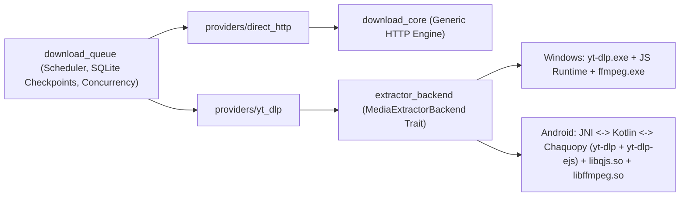

# HyperDownload — `yt-dlp` Feasibility Report & Prototype Plan

> **Document Status:** Phase 0 Technical Feasibility Report & Prototype Plan (Revised)  
> **Primary Reference:** [yt-dlp/yt-dlp](https://github.com/yt-dlp/yt-dlp) & [yt-dlp Wiki](https://github.com/yt-dlp/yt-dlp/wiki)  
> **Decision Record:** See [ADR-0002](./decisions/ADR-0002.md)

---

## 1. Executive Summary & Architectural Role

HyperDownload's primary product goal includes URL-based media downloading from publicly accessible videos and authorized media sources—discovering genuine available formats (real format IDs, resolutions, FPS, codecs, exact/estimated file sizes), inspecting playlists, letting users pick single or separate video+audio formats merged via FFmpeg, and reporting extraction or download failures truthfully.

### Why `yt-dlp` Behind `MediaExtractorBackend`?

- **Do Not Reimplement Extraction Logic in Rust:** Media platforms rotate player JavaScript, signature ciphers, and `n`-challenge algorithms frequently. Reimplementing an unofficial extractor in Rust is brittle and unnecessary.
- **Independent `MediaExtractorBackend` Abstraction:** `rust/crates/extractor_backend` defines the backend-agnostic `MediaExtractorBackend` trait, and `rust/crates/providers/yt_dlp` adapts `yt-dlp` into `provider_api::MediaProvider`.
- **Modularity Without Pipeline Duplication:**
  - `providers/direct_http` + `download_core` handle generic HTTP/HTTPS file transfers with strict byte-range integrity (`206 Partial Content`, `If-Range`, `ETag`), segmented downloads, and deterministic retries.
  - `providers/yt_dlp` delegates inspection, playlist enumeration, DASH/HLS segment downloads, and FFmpeg stream muxing to `MediaExtractorBackend` (`yt-dlp`), while **`download_queue` and `persistence` remain the single source of truth** for scheduling, concurrency limits, SQLite durable checkpoints, `DownloadFormatChoice` deduplication, cancellation, and UI `StreamSink` events.



---

## 2. Windows Feasibility Evaluation

### 2.1 Host Environment Check (`Windows 11 25H2, windows_x64`)

Live inspection of the local development machine recorded:
- **Node.js:** `node.exe` version `24.16.0.0` at `C:\Program Files\nodejs\node.exe` (satisfies `Node.js >= 22.0.0`).
- **Python:** `python.exe` version `3.9.150.1013` at `C:\Users\MuhammadAli\AppData\Local\Programs\Python\Python39\python.exe` (**too old** for both modern `yt-dlp` `3.11+` and Android Chaquopy `buildPython` matching Python `3.13`).
- **`yt-dlp`, `deno`, `ffmpeg`:** Not currently installed on `PATH`.

### 2.2 Bundled `yt-dlp.exe` vs. System Python Integration

| Criteria | Standalone `yt-dlp.exe` (PyInstaller Release) | System Python + `pip install yt-dlp[default]` |
| :--- | :--- | :--- |
| **Python Version Risk** | Bundles its own compatible Python runtime + `yt-dlp-ejs` challenge scripts internally. Works on clean Windows PCs with no Python or outdated Python (such as this host's **Python 3.9**, whereas `yt-dlp` dropped Python 3.10 in release `2026.10.26` and requires **Python 3.11+**). | Fails unless target machine has Python 3.11+ and `pip` properly configured. Unacceptable for end-user desktop installs. |
| **Distribution & Sandboxing** | Single executable placed in `%LOCALAPPDATA%\HyperDownload\bin\yt-dlp.exe` (user-writable without UAC elevation). | Pollutes global Python site-packages or requires manually shipping a portable CPython tree. |
| **Update Mechanics** | Self-updatable via `yt-dlp.exe --update-to stable` (or `nightly`) or app-managed SHA-256 verified GitHub Release replacement. | Requires invoking `pip install -U` in a managed virtualenv. |
| **Verdict** | **Recommended** for Windows production and Phase 2 prototype. | Not recommended for end-user Windows builds. |

### 2.3 JavaScript Runtime Requirements for Modern YouTube Extraction (`yt-dlp-ejs`)

Current `yt-dlp` YouTube extraction requires an external JavaScript runtime alongside `yt-dlp-ejs` challenge solver scripts to solve `n`-parameter and signature challenges (omitting a JS runtime causes missing high-resolution DASH formats and HTTP 403 / anti-bot failures):

| Runtime | `yt-dlp` Default Status | Required Minimum Version | Notes & Windows Evaluation |
| :--- | :--- | :--- | :--- |
| **Deno** (`deno.exe`) | **Enabled by default** | **`>= 2.3.0`** | Sandboxed by default (no FS/network permissions). Must use full `deno` binary, not `denort`. |
| **Node.js** (`node.exe`) | Disabled by default (`--js-runtimes node`) | **`>= 22.0.0`** | **Already verified on this host (`v24.16.0`)**. Immediately usable via `--js-runtimes "node:C:\Program Files\nodejs\node.exe"`. |
| **QuickJS / QuickJS-ng** (`qjs.exe`) | Disabled by default (`--js-runtimes quickjs`) | **QuickJS `>= 2025-4-26`** *(recommended; `yt-dlp` hard floor is `2023-12-9`, but older builds lack bytecode/regex optimizations and can hang or take minutes)*; **QuickJS-ng** (all versions supported) | Compact MIT-licensed embeddable binary (~1–2 MB), matching our Android `libqjs.so` strategy. |
| **Bun** | Deprecated / discouraged | — | Do not use. |

**Windows Recommendation:** Use `--js-runtimes` auto-detection prioritizing local/bundled **Deno `>= 2.3.0`**, **QuickJS `>= 2025-4-26`**, or installed **Node.js `>= 22.0.0`**.

### 2.4 FFmpeg Integration & Extractor Updates on Windows

- **FFmpeg (`--ffmpeg-location`):** Required for merging separate DASH video-only and audio-only streams (`Downloaded -> Merging -> Completed`). Run `ffmpeg.exe`/`ffprobe.exe` out-of-process from `%LOCALAPPDATA%\HyperDownload\bin\` (or user-configured path) so FFmpeg is never statically linked into Rust.
- **Extractor Updates:** Support SHA-256 verified updates of `yt-dlp.exe` inside `%LOCALAPPDATA%\HyperDownload\bin\` (`Stable` or `Nightly` channel) via `yt-dlp.exe --update-to stable|nightly`.

---

## 3. Android Feasibility Evaluation

Unlike Windows, Android 10+ (API 29+) enforces strict `W^X` and SELinux `execute_no_trans` policies preventing `execve()` on files downloaded into writable app directories (`filesDir` / `cacheDir`). Any native executable invoked on Android must be packaged in `jniLibs/<abi>/` and extracted to `applicationInfo.nativeLibraryDir`.

### 3.1 Option Comparison: `youtubedl-android` vs. Chaquopy vs. Custom Kotlin `ProcessBuilder`

| Evaluation Dimension | Option A: `youtubedl-android` (`0.18.1`) | Option B: Chaquopy `17.0.0` (`>= 16.0.0`) + `libqjs.so` + `libffmpeg.so` *(Recommended)* | Option C: Custom Kotlin `ProcessBuilder` |
| :--- | :--- | :--- | :--- |
| **Maintenance Status** | Active fork by `JunkFood02` (Nov 2025, powers *Seal*) | Very active official Gradle plugin (`chaquo/chaquopy`; `17.0.0` released Dec 2025) | Self-maintained NDK build scripts |
| **Wrapper License** | **GPL-3.0** (copyleft requirement on entire Android app) | **MIT** (free/unrestricted since v12.0.1+) | First-party Kotlin (Permissive) |
| **Android Python Version** | Bundled CPython inside `.zip.so` | **Python `3.13`** (`3.13.9` in Chaquopy `17.0.0`, optimal for 16 KB page support) | Self-compiled CPython `3.13` `.so` |
| **Host Build Prerequisite** | Prebuilt AARs from Maven Central | **Host Python `3.13.x` required** (`buildPython` must match app major.minor in Chaquopy 17+) | Full Android NDK CPython cross-build |
| **EJS & `yt-dlp-ejs`** | Bundles `libqjs.so` + `yt-dlp` bundle | Explicitly installs **`yt-dlp` + `yt-dlp-ejs` + `certifi`** via Chaquopy `pip` (excluding GPL `mutagen`), plus bundled **`libqjs.so`** (`>= 2025-4-26`) | Same `libqjs.so` + pure-Python `yt-dlp` + `yt-dlp-ejs` |
| **ARM64 & 16 KB Alignment** | `arm64-v8a` (+ `armeabi-v7a`, `x86`, `x86_64`) | `arm64-v8a` & `x86_64` — Chaquopy `16.0.0+` / `17.0.0` natively supports Android 15+ **16 KB page alignment** | Requires manual NDK r28+ rebuilds |
| **APK / AAB Size Impact** | Split/AAB (`arm64-v8a`): ~35–45 MB; Universal APK: ~120+ MB | Per-ABI split/AAB (`arm64-v8a`): Python `3.13` (~15–22 MB) + `libffmpeg.so`/`libffprobe.so` (~15–20 MB) + `libqjs.so` (~1–2 MB) + `yt-dlp` wheels (~3 MB) | ~35–45 MB per ABI split |
| **Runtime Updates** | `updateYoutubeDL(STABLE / NIGHTLY)` | Pure-Python `yt-dlp` + `yt-dlp-ejs` wheels fetched to `filesDir` and prepended to `sys.path` (**W^X compliant**) | Pure-Python zipapp fetch to `filesDir` |

### 3.2 Complete Chaquopy (`17.0.0` / Python `3.13`) Feasibility & Packaging Design

1. **Android & Host Python Versions:**
   - **Target Android Python Version:** **Python `3.13`** via **Chaquopy `17.0.0`** (minimum `16.0.0` for 16 KB page-size support; `17.0.0` updates runtime Python to `3.13.9`, `pip` to `25.3`, `certifi` to `2025.8.3`, fixes Flutter `settings.gradle` `plugins {}` compatibility, and requires `minSdk >= 24`).
   - **Host Build Prerequisite (`buildPython`):** Chaquopy `17.0.0` requires `buildPython` on Windows to match the **exact major.minor (`3.13`)** of the Android Python version. Our host audit detected only **Python `3.9.150.1013`**; therefore, installing **Python `3.13.x`** on Windows is a mandatory prerequisite before Phase 3 Android builds:
     ```kotlin
     chaquopy {
         defaultConfig {
             version = "3.13"
             buildPython("C:/Users/<User>/AppData/Local/Programs/Python/Python313/python.exe")
             pip {
                 // Chaquopy 17 defaults to --only-binary; explicitly include yt-dlp AND yt-dlp-ejs
                 install("yt-dlp")
                 install("yt-dlp-ejs")
                 install("certifi")
                 // Deliberately exclude 'mutagen' (GPL-2.0+)
             }
         }
     }
     ```
2. **Runtime Updates for Both `yt-dlp` and `yt-dlp-ejs`:**
   - Because `yt-dlp-ejs` challenge solver scripts evolve alongside YouTube extractor fixes in `yt-dlp`, the Android runtime updater downloads **both** pure-Python `py3-none-any.whl` artifacts (`yt_dlp` and `yt_dlp_ejs`), verifies SHA-256 digests, unpacks them into `context.filesDir/yt_dlp_override/`, and inserts that folder at `sys.path[0]` before importing `yt_dlp`.
   - Pure-Python bytecode execution runs inside the Chaquopy CPython VM, avoiding `W^X` `noexec` violations on `filesDir`.
3. **Exact Packaging of `libqjs.so`, `libffmpeg.so`, and `libffprobe.so`:**
   - Android permits invoking native CLI executables only from `context.applicationInfo.nativeLibraryDir`.
   - Cross-compile **QuickJS (`>= 2025-4-26`)** and **FFmpeg/FFprobe (LGPL build recommended)** as Position Independent Executables (PIE) for `arm64-v8a` and `x86_64` using Android NDK `28.2.13676358` / `29.0.14206865`, naming outputs `libqjs.so`, `libffmpeg.so`, and `libffprobe.so` inside `apps/client/android/app/src/main/jniLibs/<abi>/`.
   - **Mandatory Gradle & Manifest Settings:**
     - `AndroidManifest.xml`: `<application android:extractNativeLibs="true" ...>`
     - `apps/client/android/app/build.gradle.kts`:
       ```kotlin
       android {
           packaging {
               jniLibs {
                   useLegacyPackaging = true
               }
           }
       }
       ```
       *(Without `useLegacyPackaging = true` and `extractNativeLibs = "true"`, AGP 8+ stores `.so` files uncompressed inside the APK archive rather than extracting executable binaries onto `nativeLibraryDir`, causing `subprocess.Popen` / `execve` to fail with `ENOENT`.)*
   - **Symlink Shim Directory for `ffmpeg` / `ffprobe`:**
     - `yt-dlp`'s `FFmpegPostProcessor` expects binaries named `ffmpeg` and `ffprobe` (not `libffmpeg.so`). At initialization, Kotlin creates POSIX symlinks inside `<context.filesDir>/bin/`:
       - `<filesDir>/bin/ffmpeg -> <nativeLibraryDir>/libffmpeg.so`
       - `<filesDir>/bin/ffprobe -> <nativeLibraryDir>/libffprobe.so`
       - `<filesDir>/bin/qjs -> <nativeLibraryDir>/libqjs.so`
     - Passes `"ffmpeg_location": "<filesDir>/bin"` and `"js_runtimes": {"quickjs": {"path": "<nativeLibraryDir>/libqjs.so"}}` to `YoutubeDL(ydl_opts)` (with `LD_LIBRARY_PATH=<nativeLibraryDir>` if FFmpeg uses sibling shared `.so` dependencies).
4. **ABI Compatibility & 16 KB Page Alignment (Android 15+ Mandatory):**
   - **Target ABIs:** `arm64-v8a` (production devices) and `x86_64` (Windows Android Emulator `35.5.10.0`), shipped via Android App Bundle (`.aab`) ABI splits.
   - **16 KB Alignment Verification:**
     - `libengine_ffi.so` compiled with NDK `28.2.13676358` / `29.0.14206865` automatically receives 16 KB ELF alignment (`-Wl,-z,max-page-size=16384` default in NDK r28+).
     - Chaquopy `17.0.0` + Python `3.13` ships 16 KB page-aligned native libraries.
     - `libqjs.so`, `libffmpeg.so`, and `libffprobe.so` must be compiled with NDK r28+ (or `-Wl,-z,max-page-size=16384 -Wl,-z,common-page-size=16384`) and verified in CI/build checks via `llvm-objdump -p <file.so>` confirming all `LOAD` segments report `align 2**14` (16,384 bytes) or `2**16`.

---

## 4. Licensing & Bundled Dependency Audit (Windows & Android)

| Component | Windows Packaging | Android Packaging | License | Compliance & Attribution Action |
| :--- | :--- | :--- | :--- | :--- |
| **HyperDownload Core (`apps/client`, `rust/crates/*`)** | App executable + `engine_ffi.dll` | App APK/AAB + `libengine_ffi.so` | Project License | Clean permissive Rust crate tree (`tokio`, `reqwest`, `rusqlite` SQLite public domain, `serde`, `thiserror` — MIT/Apache-2.0). |
| **`yt-dlp`** | Standalone `yt-dlp.exe` in `%LOCALAPPDATA%\HyperDownload\bin\` | Pure-Python wheel via Chaquopy `pip` | **The Unlicense** | Public domain; include notice in Open Source Licenses screen. |
| **`yt-dlp-ejs`** | Bundled inside `yt-dlp.exe` | Pure-Python wheel via Chaquopy `pip` | **The Unlicense** (with MIT/ISC JS deps) | Include MIT/ISC attribution notices in Settings -> Open Source Licenses. |
| **`mutagen` (Python)** | *(Note: PyInstaller official `yt-dlp.exe` bundles `mutagen`)* | **Explicitly Excluded** from Chaquopy `pip` | **GPL-2.0+** | **Important:** On Windows, either build a clean `yt-dlp` binary without `mutagen` or trigger user-initiated `yt-dlp.exe` download outside app installer + publish full GPLv2+ notice & source link. On Android, omitting `mutagen` keeps the Python runtime GPL-free. |
| **Chaquopy** | N/A | Gradle plugin + runtime (`17.0.0`) | **MIT** | Include MIT license text in Notices. |
| **CPython (`3.13`)** | Bundled inside `yt-dlp.exe` | Embedded by Chaquopy | **PSF-2.0** | Include PSF license notice. |
| **`certifi`** | Bundled inside `yt-dlp.exe` | Chaquopy `pip` | **MPL-2.0** | Include MPL-2.0 notice. |
| **QuickJS (`qjs` / `libqjs.so`)** | Optional `qjs.exe` (`>= 2025-4-26`) | `jniLibs/<abi>/libqjs.so` | **MIT** | Include MIT license text in Notices. |
| **Deno / Node.js** | `deno.exe >= 2.3.0` or user `node.exe >= 22.0.0` | N/A | **MIT** | Include MIT license text if Deno is bundled. |
| **FFmpeg / FFprobe** | External `ffmpeg.exe` / `ffprobe.exe` CLI subprocess | External `libffmpeg.so` / `libffprobe.so` CLI subprocess | **LGPL v2.1+** *(recommended build)* or **GPL v2+/v3** *(if `--enable-gpl` / `x264` enabled)* | Never statically link into Rust. Use LGPL-only build flags for container remuxing (`-c copy`, AAC/Opus/VP9/AV1) so LGPL compliance requires only attribution + dynamic/replaceable binary notice, or comply fully with GPL source-offer obligations if shipping GPL FFmpeg codecs. |

---

## 5. Security, Compliance & UI Terminology Boundaries

1. **No Circumvention of Access Controls:**
   - HyperDownload **never** passes `--cookies`, `--cookies-from-browser`, login credentials, or session tokens to bypass paywalls, private videos, members-only streams, or age-restricted account gates.
   - Any format with `has_drm == true` is blocked and tagged `FormatAvailability::BlockedDrmOrAccessRestricted`.
2. **Distinguishing Technically Discovered Formats from Legal Authorization:**
   - Technical discovery (`FormatAvailability::DiscoveredSingle` / `FormatAvailability::DiscoveredRequiresMuxing`) proves only that the technical metadata/stream endpoint was returned by the server or `yt-dlp`—**never** that the user holds copyright permission or Terms of Service authorization to download it.
   - The Media Inspection and Format Selection UI explicitly uses **"Discovered Formats"** / **"Technically Available"** terminology paired with a concise rights/Terms of Service compliance reminder ([YouTube Terms of Service](https://www.youtube.com/t/terms)).
3. **Input & Command Injection Protection:**
   - Strict `url::Url` validation (`http` / `https` schemes only).
   - Typed array process arguments (`Command::args(...)`), never shell-interpolated strings.
   - Filename sanitization preventing directory traversal (`..`, `/`, `\`, Windows reserved device names).

---

## 6. Working Prototype Plan & Revised 4-Phase Sequence

### Revised 4-Phase Implementation Roadmap

- **Phase 1 — Minimal Flutter + Rust FRB v2 Verification:** Scaffold `apps/client` + `rust/crates/engine_ffi` with a trivial FRB round-trip (`ping` / `engine_version`), verifying **Debug and Release** builds on **Windows Desktop** and **Android** (including 16 KB alignment check on `libengine_ffi.so`).
- **Phase 2 — Windows `yt-dlp` Prototype:** Validate standalone `yt-dlp.exe` + external JS runtime (`Node.js 24.16.0` / `Deno >= 2.3.0` / `QuickJS >= 2025-4-26`) + `ffmpeg.exe` across all 6 media extraction scenarios below.
- **Phase 3 — Android `yt-dlp` / Chaquopy Feasibility Prototype:** Validate Chaquopy `17.0.0` (Python `3.13` + Windows host `buildPython 3.13`), `yt-dlp` + `yt-dlp-ejs`, `libqjs.so` + `libffmpeg.so` (`useLegacyPackaging = true`, `extractNativeLibs = true`, `llvm-objdump` 16 KB check), JNI <-> Kotlin <-> Python progress hooks, child-process termination on cancellation, and W^X-safe runtime wheel updates in `filesDir`.
- **Phase 4 — Shared Engine & Full Application:** Implement `media_models`, `persistence` (continuous WAL checkpoints), `connection_manager`, `download_core` + `test_server`, `download_queue`, `HyperDownloadJobService` (UIDT + `SIGKILL` recovery), and all 7 Flutter Bloc UI screens.

### Prototype Verification Scenarios (Phases 2 & 3)

Using an authorized Creative Commons / public domain test video (e.g., Blender Foundation open media) and a public open playlist:
1. **Inspect a Test Video:** `yt-dlp --dump-single-json --no-playlist --no-warnings --ignore-config --js-runtimes ... <URL>` -> map `id`, `title`, `description`, `uploader`, `thumbnail`, `duration`.
2. **Discover Actual Formats:** Map `formats[]` into `MediaFormat`, filtering out storyboards and `has_drm == true`, separating `filesize` (exact) from `filesize_approx` (`is_size_estimated: true`), and building `DownloadFormatChoice::Single` vs `DownloadFormatChoice::MergedVideoAudio`.
3. **Inspect a Playlist:** `--dump-single-json --flat-playlist` preserving 0-based `order_index` and setting per-item `PendingInspection`.
4. **Select a Format:** Validate `-f "<id>"` (muxed or audio-only) and `-f "<video_id>+<audio_id>"` (video+audio muxed pair).
5. **Download with Structured Progress & Pause/Cancel:** Stream `download:HYPERDL|...` progress lines (`--newline --continue`), cancel gracefully (and test `SIGKILL`/hard termination recovery), and verify `--continue` resumes cleanly.
6. **Merge Separate Audio & Video with FFmpeg:** Run `-f "<video_id>+<audio_id>" --ffmpeg-location <dir> --merge-output-format mp4` with `postprocess:HYPERDL_PP|...`, verifying `Downloading -> Merging -> Completed` and valid dual-stream MP4 output.
